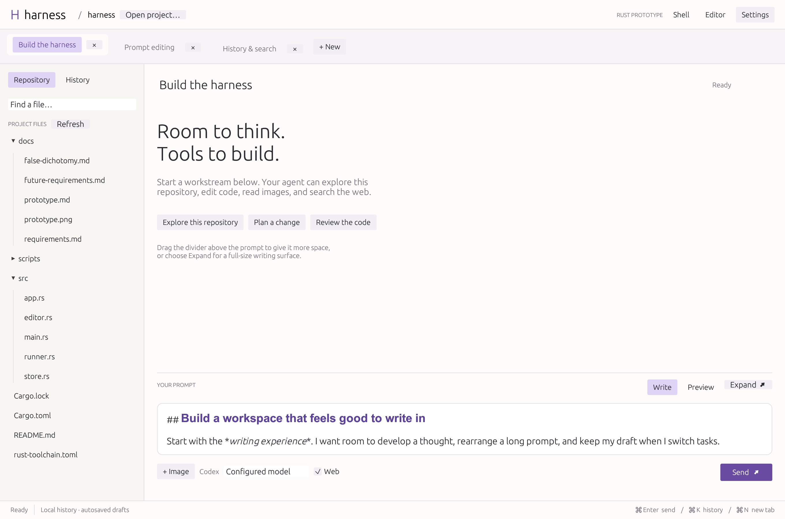

# Rust prototype

Skyforge is a native macOS desktop prototype written in Rust, using egui/eframe. It has no Electron or browser runtime. It implements enough of the [first-release requirements](requirements.md) to try the core workflow; it is not the finished first release.



The screenshot uses sample drafts in a separate test database.

## Run

Use the rustup toolchain and the committed lockfile. The current dependency set requires Rust 1.99 or newer. This workspace includes `rust-toolchain.toml`.

```sh
~/.cargo/bin/cargo run --release -- /path/to/project
```

For this repository:

```sh
~/.cargo/bin/cargo run --release -- .
```

To build a double-clickable macOS app:

```sh
sh scripts/bundle-macos.sh
open target/release/Skyforge.app
```

The bundle opens the last project. Use **Open project…** to add another directory as a project tab in the toolbar. Switching project tabs restores that project’s last active workstream and repository tree. The first launch uses the current directory or your home directory when launched from Finder.

## Try the workflow

1. Write a multiline prompt. Drag the divider above the composer to change its height.
2. Markdown emphasis, headings, and inline code are styled automatically as you type. Syntax characters remain editable; the prompt has no placeholder or Write/Preview controls.
3. Attach an image with **+ Image** or drag an image onto the window. A local copy and thumbnail are retained with the workstream.
4. Choose a model from the dropdown. It lists your cached Codex models, Anthropic Claude Sonnet, Opus, and Haiku, and the models advertised by your OpenAI-compatible server. Select **Send** or press **Enter** while the prompt is focused. **Shift+Enter** adds a newline. Enter in other fields does not send a prompt. The agent runs in the selected project directory.
5. Create another tab with **+ New** or **⌘ N**. Workstream tabs show only the selected project, and **+ New** starts a workstream in that project. Each workstream retains its own prompt, attachments, model setting, session, and run state. Tabs can run concurrently in the same directory.
6. Use the repository tree or filename search to open a file. Right-click a folder or file and choose **New file…** to create an empty file in that folder (beside the selected file). Use the **+** beside **PROJECT FILES**, or right-click that heading, to create a file at the project root. Enter a filename and press **Enter** or **Create**; **Escape** cancels. Existing files are never overwritten, and unsaved editor changes are protected before opening the new file. The tree automatically refreshes after external filesystem changes, including terminal `git pull`, using native notifications with no idle polling. Bursts are batched into background scans, preserving the visible tree during refresh. The resizable editor always stays in edit mode, including for Markdown, with source highlighting and saving with **⌘ S**. Press **⌘ F** while a file is open to search in a modal dialog. Matches are highlighted and the active match is selected and scrolled into view. **Enter** or **Next** advances to the next occurrence; **Shift+Enter** or **Previous** goes back, wrapping at either end. **Escape** or **Close** returns to editing. External content changes automatically reload the open file when it has no unsaved edits. If local edits conflict with a disk change, choose **Load disk version** to discard them or **Keep editing** to retain them; saving cannot overwrite the external change until the conflict is resolved.
7. Open **History** or press **⌘ K**. Search searches the entire stored conversation, including later agent responses and tool messages. Results show excerpts and support project/date filters. Selecting a result opens its matching conversation context; **Return to latest messages** returns to the current end.
8. Close a tab with **×**. Its history remains discoverable; a running task continues until it finishes or you reopen it and stop it.
9. Use **Restart** in the status bar to restart after active agent runs finish.

## Wake timers

Agents can schedule one-shot follow-ups with `schedule_wake`, inspect them with `list_wakes`, and cancel them with `cancel_wake`. These tools are available in both Builder and Thinker: Codex and Claude use MCP; DeepSeek and other OpenAI-compatible models use the same service through function calling.

For example, ask an agent: “Check this job again in an hour, then continue here.” The scheduling tool takes `request_id`, `instructions`, and exactly one of `delay_seconds` (1 second to 365 days) or `at` (an RFC3339 timestamp with a timezone). Reusing the same request ID and arguments within a turn returns the original timer instead of creating a duplicate.

Scheduling returns immediately. The agent should finish its current turn; Skyforge starts another turn in the same workstream when the timer is due. Builder resumes its provider session; Thinker rebuilds its conversational context. Delivery uses the workstream's current model and current host permissions, waits for any active run in that workstream, and preserves unsent drafts and attachments. The transcript labels scheduled input **WAKE**. A reminder continues existing work and grants no additional user authorization.

Open **Wake timers** in the bottom status bar to see pending timers, open their conversations, or cancel them. Closing a tab or project leaves its timers active. **Stop run** cancels that workstream's pending timers and stops the run. Failed starts remain visible with **Retry wake** and **Cancel timer** controls.

Timers are stored in SQLite and survive closing or restarting Skyforge. Keep Skyforge running and the computer awake for timely delivery; overdue timers run after reopening. Dispatch pauses while restarting or shutting down. If Skyforge closes during dispatch, it marks the timer interrupted for manual inspection/retry rather than automatically repeating potentially started work. Dispatch receipts mean a turn was started, not that its task succeeded. Inspect the conversation before retrying. Wake timers do not wake the computer or run while Skyforge is closed, and recurrence rules are not supported.

## Restarting Skyforge

Use **Restart** in the bottom status bar. If an agent run is active, the button becomes **Cancel restart** and Skyforge waits for every run, including runs in closed tabs, to finish. You can cancel while waiting. Unsaved file-editor changes offer Save, Discard, or Keep working before closing. Drafts, messages, sessions, open tabs, and the selected tab are retained.

Agents launched by this version can also request a restart when you ask them to:

```sh
"$HARNESS_EXECUTABLE" --request-restart
```

Skyforge supplies a private restart inbox through the run environment and adds the command to the agent's runtime instructions. This command records a restart request; it does not launch a GUI, stop the current run, or execute arbitrary host commands. Skyforge itself closes its workers/database and launches its own executable after the GUI exits. Restart requests do not change agent permissions. Relaunching uses the executable at the current app path, so rebuild the bundle with `sh scripts/bundle-macos.sh` first to load code changes in a bundled app.

You must manually reopen the new build once to install this capability into the running GUI. Older instances have no restart inbox. The command without a Skyforge-supplied environment reports an error instead of starting another app.

## Agent backend

The Codex backend uses the installed Codex CLI through its JSON event interface. It reuses your existing login and configuration. See the [official non-interactive mode documentation](https://developers.openai.com/codex/noninteractive/) and [CLI reference](https://developers.openai.com/codex/cli/reference/).

Select the Codex or Claude Code executable in **Settings** if automatic discovery does not find it. The prototype can also discover the CLI bundled in an existing macOS Codex VS Code extension installation; it does not run the extension itself.

- Choose **Codex · Default model** to use your configured default, or a named model from the local Codex model cache. Existing custom model IDs remain selectable.
- Live search is controlled in **Settings**; there is no Web checkbox in the composer.
- Claude choices use the installed Claude Code CLI and its existing login. The stable `sonnet`, `opus`, and `haiku` aliases are resolved by that CLI. Sign in with `claude` outside Skyforge first if needed.
- Changing providers starts a new agent session and keeps the visible workstream history. Changing models within a provider retains its session.
- Claude exchanges newline-delimited JSON with Skyforge, including base64 image blocks. Agent text, tool activity/results, permission denials, and errors are shown in the conversation.
- Claude Builder runs use non-interactive `bypassPermissions` with its shell sandbox disabled. Read-only runs use `dontAsk` and omit shell execution and editing tools entirely; this is not an OS-level read-only guarantee.
- Builder runs have full filesystem read/write access with the current user account permissions by default. Codex uses `danger-full-access`, Claude disables its shell sandbox, and local models run commands directly. Disable **Allow Builder full filesystem access** in Settings for read-only runs. Thinker always uses its separate read-only Chatbot profile; see [Thinker projects and memory](thinker.md).
- Runs are non-interactive: Codex approval policy is `never`, and Claude Builder uses `bypassPermissions`. OS permission errors are returned to the agent instead of blocking on a hidden approval prompt.
- Subsequent prompts resume that workstream's exact session with the selected provider. The selected backend retains model-side session history; SQLite retains the GUI's history and drafts.
- Agent events show completed messages, command activity/output, file changes, search activity, diagnostics, and errors. Agent messages appear when the CLI emits its item events; token-by-token streaming is not implemented.
- **Stop run** terminates the run's process group, including ordinary child shell processes. Application exit also stops active runs.

## Local models

In **Settings**, under **OpenAI compatible model**, enter the server's **Host** and **API key**. Every settings edit saves automatically. Skyforge discovers available model IDs from `/v1/models` at startup and after host or API-key edits, once typing pauses. **Refresh server models** reloads that list. Choose a specific **Local · …** model in the composer; each workstream retains its choice and sends that exact ID. The optional **Model name** field supplies a default or a manual ID for servers without model discovery.

The host can be `http://192.168.1.35:8000/v1` (a missing `/v1` suffix is added). The key is masked in the UI and retained in the local SQLite settings database, whose file permissions are restricted to its owner. No API key is compiled into Skyforge. The local provider directly uses `/v1/chat/completions` and OpenAI-compatible function calls; it does not require a Codex or Claude login. The server must support tool calling. Image support depends on the selected model.

The local agent has project file listing, file reading, exact text edits, file creation, and command execution for builds and tests. `list_files` accepts an optional directory `path` and recursively lists files, excluding ignored files; an omitted or empty path lists the project. Listings use project-relative paths inside the project and absolute paths outside it. Writable runs accept absolute paths and paths relative to the project, including paths outside the project. Commands run directly under the current user account in a login shell, from the project directory, with a private temporary directory. Login-shell setup supplies the development-tool PATH even when Skyforge is launched from Finder. With Builder full filesystem access disabled, only project listing and reading tools are offered, and file paths remain confined to the project. Local runs have no built-in web-search tool. Stop cancels in-flight HTTP requests and tool processes, including their process groups.

Completed command messages show the exact shell command above its output. Every local tool result is limited to 12,000 UTF-8 bytes before display, saving, or inclusion in the next model request, independently of compaction. Oversized results retain their beginning and end with an explicit truncation notice; use targeted commands or file ranges to retrieve more. Resuming an older session also bounds previously oversized tool results.

Direct model responses show prompt cache hit and miss token counts underneath, including tool-only responses and history summary calls. DeepSeek's explicit counts are used when available; other OpenAI-compatible providers can supply cached token counts, with misses calculated from total prompt tokens. Missing metrics display as unavailable rather than zero. These counts are saved in the conversation view but are not added to model context. Codex and Claude CLI responses do not receive these metrics.

Set **Context size (tokens)** in Agent settings for each exact model ID to the context window configured on your server (32,768 tokens by default). **Maximum output (tokens)** controls both the main request's `max_tokens` and the compactor's output reserve. Automatic mode uses a positive output limit advertised by the server's model list when available; otherwise it defaults to 16,384 tokens, or 32,768 for models identified as supporting reasoning. Automatic limits use at most half the configured context window to leave useful room for input. Server-advertised limits and reasoning capabilities are cached per host/model and survive restart. Existing explicit overrides remain unchanged; enable **Use automatic output limit** to return to the new defaults. Explicit limits are also bounded by a known server output maximum. Include thinking tokens where the server counts them as generated output. The effective limit is capped to leave at least 1,024 input tokens plus 512 tokens of headroom; compaction can still report that preserved input or tool schemas do not fit. Both settings save automatically.

**Reasoning replay** offers Auto, Omit, Current turn, and Preserve history. Overrides apply to the combination of host URL and exact model ID. Auto preserves history for identifiable DeepSeek, Magistral/Mistral API, and Qwen3.6/3.7/3.8 models; original Qwen3 models retain only the current user turn's reasoning, and unknown models omit it. Explicit reasoning fields, leading `<think>` blocks, and Mistral thinking chunks are retained in private session history while ordinary answers remain visible in the UI. Replay includes reasoning in the estimated input budget. Newer Qwen requests also set `preserve_thinking` (directly for Alibaba/QwenCloud, through `chat_template_kwargs` for local servers); the server must support that control. Selecting Omit on the official DeepSeek API explicitly disables thinking so tool requests do not violate its replay requirement.

Local requests estimate context usage from serialized bytes, including tool definitions, and compact older history around 80% usage or when the output reserve requires it. Token estimates are approximate and image attachments can make them conservative. Compaction preserves system instructions and every original user message and attachment. Omit protects the latest tool exchange; replay modes protect the entire current user turn, including every reasoning/tool step. Older tool exchanges become tool/file/status records; shell file access is not guessed. Only the first three and last ten older tool records or agent outputs remain, with retained agent outputs summarized into concise lines by the same model in one bounded request. If summarization fails, short labeled excerpts are used. In replay modes, older recaps are user messages containing historical data, rather than fabricated assistant replies without reasoning. Preserve history replays reasoning for assistant messages still retained verbatim; compacted exchanges are replaced by recaps, including their removal from reasoning history. Compaction affects only requests; the saved transcript remains available. If the current turn and other preserved content exceed the budget, the run stops rather than silently discarding required reasoning.

Conversations, including tool calls and results, are saved in owner-only `local-sessions/` files so follow-up prompts resume after restarting Skyforge. Completed text and tool results appear in the conversation; token streaming is not implemented. Requests have a five-minute timeout and each agent turn is limited to 64 tool iterations. Writable runs can use a dedicated tool to request Skyforge's usual deferred restart.

After a dispatched request fails, stops, or is interrupted, **Retry request** appears below the conversation. It uses the saved request, attachments, and model selection. Retry state survives reopening Skyforge and leaves any unsent draft intact. Local retries retain completed tool results and do not duplicate the original user message. Sending a new request replaces the previous retry state.

Local server errors include the HTTP status, model, endpoint, and server-supplied details. If the server supplies only a generic inference error, its internal logs are needed to establish the cause.

Local-model chat requests and responses are logged as JSONL in `logs/local-model/YYYY-MM-DD.jsonl` under the application data directory (normally `~/Library/Application Support/Skyforge/` on macOS; existing Harness installations retain their data directory). `HARNESS_DATA_DIR` also relocates the logs. Each record includes a UTC timestamp, request ID, model, endpoint, direction, HTTP status when available, and the original wire body before parsing or formatting recovery. Logs include tool follow-ups, correction requests, HTTP error bodies, and transport failures, with owner-only file permissions and no Authorization headers. Request and response JSON does not appear in the conversation or get added to SQLite history. Older stored wire diagnostics are hidden in the conversation. Logs are split by UTC date and retained until you delete them.

The same logfile includes structured tool-use telemetry for direct model calls (not Codex/Claude CLI). `model_tool_use` records describe accepted responses, including zero-tool responses, rejected responses, output truncation, and API errors. Accepted records contain normalized tool names and call IDs; available tool names are included so comparisons can account for mode and permissions. `tool_execution` records mark actual execution starts and finishes with tool name/call ID, success/failure/cancellation or partial failure, elapsed milliseconds, and output byte count before truncation. Nonzero shell exits count as failures even when the command helper returned normally. Every telemetry record includes schema version, UTC timestamp, exact model, endpoint, workstream/session, run ID, step, and the HTTP request ID that produced the calls. Join that ID to the original request/response records for arguments and provider token usage. Count only accepted response records for tool-use rates and finished execution records for outcomes; requested calls can remain unexecuted after cancellation, and unfinished start records can indicate interruption. Logging failures appear in diagnostics without stopping tools. Telemetry is not sent to the model or stored as conversation messages.

Local responses recover common formatting mistakes automatically: missing or incomplete JSON fences, trailing commas, and literal control characters inside JSON strings. Tool calls can use object arguments, a single call instead of an array, missing IDs, a `functions.` name prefix, or the legacy `function_call` format. Whole-response JSON tool envelopes and `<tool_call>` wrappers are converted to structured calls; examples embedded in explanatory prose are left as text. Final-only Harmony wrappers and leading closed `<think>` blocks are removed from user-facing answers. Tool recipients in unparsed Harmony output require model correction rather than guessing how to execute them.

All calls in a response are validated against the tools and argument schemas available for the run before any are executed. Missing values, unknown tools, invalid types, and ambiguous formats trigger up to two automatic requests for the model to correct its response. Rejected calls execute no tools; transient correction requests are excluded from saved session history. Recovery notices appear in diagnostics; rejected raw responses remain in the log. Exhausted corrections and truncated output remain visible failures with **Retry request** available. These fallbacks do not replace a correctly configured server chat template or tool-call parser.

For one-time setup, a private, ignored `.harness/local-model.json` in the project can contain `host`, `api_key`, and `model`. The GUI imports these fields into settings and deletes the file after successfully saving them.

## Appearance

Skyforge defaults to a palette based on VS Code’s Dark Modern theme: dark gray editor and sidebar surfaces, light gray text, and blue controls. The prompt uses 20 pt text, with larger Markdown headings. UI body text is 19 pt and buttons are 18 pt; other UI text is two points larger than the previous build. Control and selection foreground/background pairs live in `src/theme.rs`, and automated checks enforce a contrast ratio of at least 4.5:1 for the shared pairs. Selected tabs and Send use white text on the same blue background. On macOS it loads the system San Francisco UI font and Menlo code font, with bundled fallbacks when unavailable. These match the default macOS font families found in the installed VS Code / Codex CSS; bold Markdown uses a separate bold face. Codex also [honors VS Code’s chat font settings](https://developers.openai.com/codex/ide/settings).

## Storage and performance approach

New installations store local state in `~/Library/Application Support/Skyforge/` on macOS. If an existing `~/Library/Application Support/Harness/history.sqlite3` is present, Skyforge continues using that directory in place, preserving history, settings, sessions, and absolute attachment paths.

- `history.sqlite3` and SQLite WAL files: workstream metadata, drafts, messages, settings, and persistent wake timers.
- `attachments/`: durable copies of attached images.

Set `HARNESS_DATA_DIR` to use a separate data directory for testing. The historical `HARNESS_*` environment variables and internal integration identifiers remain supported for compatibility. SQLite stores conversation history, Thinker projects, and shared / project-scoped Thinker memories. The broader coding-agent memory design remains a future capability.

Draft changes are saved after a short debounce and when switching tabs or exiting. On restart, previously running workstreams become **Interrupted**, rather than claiming that their processes are still alive. Only the active conversation's recent 100 messages are loaded initially; earlier messages can be loaded explicitly. Closed workstreams are queried from SQLite when needed.

The GUI repaints on input or worker events and uses a modest update timer during runs. Repository scanning runs in the background, respects ignore rules, excludes common generated directories, and caps its listing at 10,000 files. Output queues and individual tool output are bounded; noisy shell output is throttled and truncated after roughly 64 KB per pipe. Live conversation views retain up to 200 messages unless the user explicitly loads older context. Use release builds for performance evaluation.

Numerical M1 performance budgets and comparison with VS Code remain outstanding. A native Rust implementation alone does not establish that those requirements are met.

## Prototype limitations

- Codex and Claude Code CLIs and OpenAI-compatible local models are supported. Requests run directly with the model selected in the composer. Project-aware routing, project memory, and automatic review remain future work.
- Concurrent agents share files. The GUI warns about simultaneous runs in one project and refuses an editor save when the file has changed on disk. It does not yet coordinate agent-to-agent writes or resolve conflicts.
- Markdown composition preserves visible Markdown syntax. Rich editing, hidden syntax markers, screenshot paste from the clipboard, and a full accessibility/usability pass remain future work.
- Repository refresh is manual and automatic at the end of a visible run; there is no file watcher. Unsaved file-editor contents are protected during normal navigation/quit, but are not recovered after a crash. Prompt drafts are persisted.
- History uses SQLite substring queries rather than semantic search or a dedicated full-text index. Results are capped at 60 and filters help narrow them. It has not been benchmarked against a large archive.
- The file editor supports UTF-8 files up to 2 MB. Find highlights matches but does not yet provide next/previous navigation or replace. No language server or debugger is included.
- Settings changes apply to new runs. CLI output formats may change between versions; Codex parsing was developed against local `codex-cli 0.160.0`. Claude input, events, images, and resume arguments are covered by a subprocess fixture; live authenticated Claude requests have not been verified.
- Use one Skyforge instance per data directory. Separate instances do not coordinate live execution state.
- Image copies are retained locally, including when removed from a draft; attachment cleanup/export/deletion tooling is not implemented yet.

## Developer checks

```sh
~/.cargo/bin/cargo fmt --check
~/.cargo/bin/cargo clippy --all-targets -- -D warnings
~/.cargo/bin/cargo test
```

Tests also cover Enter/Shift+Enter behavior, shared theme contrast, restart queuing, unsaved-file protection, active-tab recovery, restart inbox cleanup, divider drag persistence, composer control visibility at the minimum window size, and Claude subprocess input/output and read-only tool restrictions. Tests exercise history discovery, draft/session restart persistence, interruption recovery, external-edit protection, Markdown source preservation, CLI event translation, and shell execution/cancellation.

Validation on 3 October 2026:

- All 10 automated tests passed, including UI rendering in normal, expanded, preview, history, and Markdown file-editor modes at that initial validation.
- Formatting and Clippy checks passed with warnings treated as errors.
- A native framebuffer capture verified window startup and rendering. The macOS bundle's property list and local code signature were validated.
- A live Codex smoke test created a file in a temporary project and successfully resumed the same session to recall the filename.
- A second live test correctly identified the application name in an attached screenshot and emitted a web-search event to retrieve the official eframe documentation URL.
- A 15-second idle sample on an Apple M1 Pro with 16 GB RAM, after startup, recorded approximately 148 MiB RSS. Process CPU time did not increase at the measurement's 0.01-second resolution. This is a short prototype observation, not a sustained-use or concurrent-agent benchmark.

For a native framebuffer smoke capture, without capturing other desktop windows:

```sh
HARNESS_DATA_DIR=/tmp/harness-smoke \
HARNESS_CAPTURE_PATH=/tmp/harness.png \
HARNESS_CAPTURE_EXIT=1 \
target/release/skyforge .
```

The capture environment variables are optional developer aids. Without them, the app does no screenshot capture.
